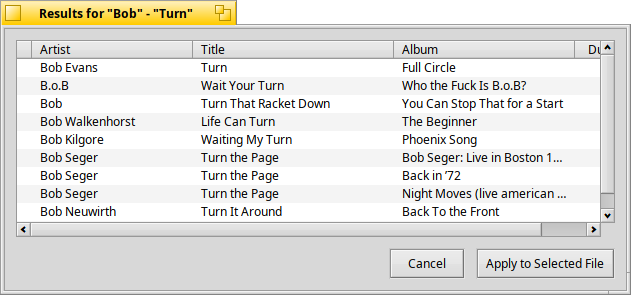

# TagView

Music Tag Viewer for Haiku.

TagView is a Haiku test/demo app for viewing and editing digital music
tags (MP3, Ogg Vorbis, FLAC), built on top of open-source libraries
including TagLib and the MusicBrainz web service.

If a dropped/opened file has no tags but its artist and song name can be
guessed from the file name, TagView can look the track up on MusicBrainz
and let you pick which result matches. The Search dialog also takes an
optional track time (m:ss), which sorts results by how close their length
is to it, and an optional album, which narrows the search to recordings on
a release with that title (and uses that release for the album, year,
track and cover art).



## Design

The app is deliberately split in two:

- **`tagkit/`** -- the reusable pieces, with no app-specific wiring: the tag
  data model, reading and writing tags with TagLib, cover art lookup and
  handling, MusicBrainz search, and views such as `CompactView`. It is a git
  submodule: its own repository,
  [github.com/scottmc/tagkit](https://github.com/scottmc/tagkit), which other
  programs (Hare, ArmyKnife) can use as well. Its documentation is in
  `tagkit/docs/index.html`, and `tagkit/tagkit.mk` is what this program's
  Makefile uses to build it in.

- **`src/`** -- the app itself: `TagViewApp`, `TagViewWindow` (menu bar +
  a `tagkit::TagView`, File > Open... and drag-and-drop of refs) and
  `SearchWindow` (Edit > Search MusicBrainz..., the Artist/Song/MusicBrainz dialog).

## Status

Working: the window with menu bar, file open (filtered to `*.mp3`,
`*.ogg`, `*.flac`) and drag-and-drop of files into the list. Each file's
tags and audio properties (artist, title, album, track, year, genre,
duration, format) are read with TagLib (`tagkit::read_tags()`) and shown
in the column list. The Search MusicBrainz... dialog (which closes as soon as the search starts) looks the track up on MusicBrainz
and applies the chosen match to the row. If there are more matches than
fit on one page, **More Results** in the results window adds the next page.
Leave the Song blank to search for
cover art only: releases by the Artist (narrowed by the Album, if given) are
checked for covers, and iTunes is asked too, so the net can be cast wider
than one recording's releases. Applying a match only changes the
row (marked with a leading bullet); **File > Save** (selected row) or
**File > Save All** writes the tags to the file(s) with TagLib, and
quitting with unsaved changes asks first.

Cover art: applying a match also looks up front covers for every release
the recording appears on. One cover is used straight away; with more than
three, a picker (thumbnails with the release title and year) opens showing
the first ones and adds the rest as they arrive. The
chosen cover shows as "New" in the Cover column and is embedded in the
file (replacing its front cover, keeping other pictures) when you save.
A preview under the list shows the cover of the last row selected -- the
pending one if you've chosen a new cover, otherwise the file's own. The
status bar reports how many releases had covers; **Edit > Choose Cover
Art...** reopens the picker for the last lookup.

The **View** menu switches between **ColumnListView** (the list with the
cover preview under it) and **CompactView** (the tags and cover art of the
last selected file in a smaller space). Select files in the list view; the
compact view shows the one selected last. This is a first pass at the
compact view. CompactView has a side menu with **Size 1**, **2** and **3**
for the text size (1 is the automatic size; 2 and 3 are larger).

Right-clicking the cover art (under the list, or the square in the compact
view) opens a menu: **Save** writes a pending cover change into the audio
file; **Insert...** opens a Tracker panel in the song's folder to pick an
image (JPEG, PNG and GIF are embedded as they are, other formats are
converted to PNG; nothing is written until Save); **Export** lists the
image formats Haiku's translators can write and opens an Export As panel
(the file name defaults to the album with the format's usual extension, e.g.
`.jpg`, `.png`, `.bmp`, `.tif`); **Remove** clears the picture from the view
and marks it for removal from the file on the next save.

Cover art also drags and drops, like in ShowImage: drop an image file from
Tracker (or an image offered by another application) onto the cover art, in
either view, and it becomes the pending cover (nothing is written until
Save); drag the cover out of the view to drop it on a Tracker window, the
desktop or another application that takes images -- as the image's own
format, or as PNG if the target asks for that.

Settings are saved in `~/config/settings/TagView` (a flattened BMessage, as
in Hare): the position and size of each window, the compact view's text size,
and the last 8 genres picked. Those recent genres head the Genre drop-down
(under "(none)"), with a line separating them from the full list.

Editing by hand: right-click the Artist, Title, Album, Track, Year, Genre
or Comment of a file -- in either view -- to change it in a small edit window
(Return or clicking elsewhere accepts typed text, Escape cancels). Genre is
a drop-down menu of the genre list borrowed from Hare (with "(none)" to
clear it, and "Other..." to type a genre that isn't in the list); picking an
entry accepts it. With several files selected and different values in the
field, the editor starts out blank and clicking away without typing leaves
the files alone (Return in the blank field, or "(none)", clears them all). The compact view shows the file's
name under the squares, handy for copying a track number into the tags. The
change shows at once but stays pending: **Apply** (lower right, under the
list or under the compact view's rectangle) keeps it as an unsaved change
to the file's row, like an applied MusicBrainz match, and **Discard
Changes** puts the values back as they were. Both buttons are greyed out
unless something is pending. File > Save then writes the tags to the
file; Save and applying a MusicBrainz match also keep any pending edits
first. Track and Year must be blank or a whole number. Quitting with
unsaved (bulleted) rows asks whether to save them.

The **Layout** menu switches the compact view's layout options on and off
for testing (they aren't remembered): **Show Duration**, **Show Format**,
**Show Comment**,
**Wide Tag Square** (the tag square 1.5 times as wide as the cover art) and
**Small Minimum Size**, which lets the window shrink to 100 x 100.

While a file has no cover art, a **Search** button (with TagView's own icon)
sits in the middle of the cover art area, in both views; pressing it does the
same as Edit > Search.... Its label is whatever the program gives to
`SetEmptyButton()`.

Several files at once: select more than one row and the compact view shows
each field with the value they all share, or "(multiple)" where they differ,
with "N files selected" under the squares. Right-click a field there to set
it for every selected file (a blank accepted for a field that differs is
ignored, except Genre's "(none)"); Apply and Discard Changes work as above.

TagKit's own words (column titles, field names, the editor and picker
windows) go through the Haiku catalog system, as `TAGKIT_USE_CATALOG` is
defined in the Makefile. TagView has no translations of its own, so they show
in English; this is here so the catalog path gets built and tested.

Every web lookup (MusicBrainz search, Cover Art Archive, iTunes) gives up
after 30 seconds, and the status bar then says it timed out rather than that
nothing was found. To try it without pulling the network cable, start TagView
with `TAGVIEW_NETWORK_TIMEOUT=1` (any number of seconds) in the environment,
e.g. `TAGVIEW_NETWORK_TIMEOUT=1 TagView`.

## Future ideas

- (nothing queued right now)

## Building

TagKit is a git submodule, so clone with it:

```
git clone --recurse-submodules https://github.com/scottmc/TagView
```

(or, in an existing clone, `git submodule update --init`). Then build with
Haiku's generic build Makefile (Makefile-Engine):

```
make
```

The resulting binary is `./TagView`.
